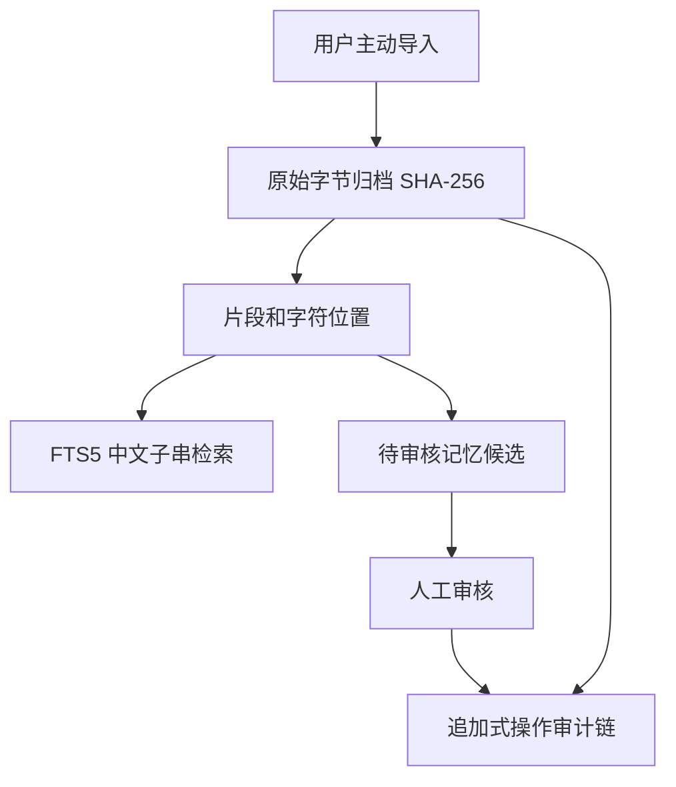

# NeuroMemory Cortex · NeuroMemory Lab v0.2

**可信个人记忆 × 可复现神经计算：构建神经启发式认知系统的实验底座。**

这个项目是 NeuroMemory Lab 的可运行原型。现在实现了：本地记忆库、授权导入、来源哈希、原文片段与位置、中文检索、待审核记忆陈述、撤销导入、操作链核验；另有 **LIF 膜电位积分、STDP 突触时间规则、Hopfield 联想记忆** 三项独立合成数据实验，以及原创的极简浅色神经场域动态界面。

**本阶段没有实现：** 人类脑组织级真实神经元网络、人脑意识、人格复制、云模型联网聊天、Agent 自动学习、PDF/照片多模态导入或安全物理删除。这些都需要独立研发与验证。

> 公开仓库不存放任何真实个人资料。所有神经场域节点均为确定性生成的艺术化合成结构，并不代表脑扫描。

## 0. 隐私与使用前须知

- **不会自动导入真实个人资料。** 启动后的数据库为空；唯一随包附带的内容是明确标注虚构的演示文件，只有你点击导入才会写入数据库。
- **不调用任何外部网络或模型。** Python 标准库即可以运行。Web 服务仅绑定 `127.0.0.1`，静态界面没有外部字体、脚本或跟踪组件。
- **所有神经计算演示独立于个人记忆库。** 点击运行实验不会读取上传资料，也不会把合成模式存成个人记忆。
- **阶段 01 尚无应用层静态加密。** 原始导入文件和 SQLite 数据库以明文储存在你指定的本地目录。正式导入敏感资料前应先确认 Windows 磁盘加密、登录权限、备份保护，并在后续阶段增加应用层加密和安全删除。
- “撤销导入”只会让来源退出有效检索，**原始归档仍然保留供审计**。这不等同于永久删除。
- 审计哈希链可发现普通数据库记录篡改，但不能抵抗能够替换整个数据库及全部链条的特权攻击者。

## 1. 在 Windows 上运行（Python 3.11+）

打开 PowerShell，进入解压后的项目目录：

```powershell
py -V
py -B -m unittest discover -s tests -v
py -B -m neuromemory_cortex --data-dir .\local_data init
py -B -m neuromemory_cortex --data-dir .\local_data serve --port 8765
```

在浏览器打开 <http://127.0.0.1:8765>。

这是本机地址，运行期间需保持终端窗口开启。按 `Ctrl+C` 关闭服务。

若要只使用合成样本体验导入功能：

```powershell
py -B -m neuromemory_cortex --data-dir .\local_data import-file .\fixtures\synthetic_demo.md --confirm
py -B -m neuromemory_cortex --data-dir .\local_data search 云灯城
py -B -m neuromemory_cortex --data-dir .\local_data stats
```

若你不想写入任何演示数据，**不要执行 `import-file`**，仅启动界面即可查看空数据库。

运行不涉及个人数据的独立神经实验：

```powershell
py -B -m neuromemory_cortex neural-demo
```

返回真实计算出的 LIF 脉冲数、STDP 权重变化、Hopfield 网络能量与恢复位数。这些是**简化模型**，而不是生物脑的测量数据。

## 2. 操作说明

1. **来源档案**：自行选取一个 UTF-8 `.md` / `.txt` 文件（不超过 2 MiB），选择分类并勾选明确授权；原始字节哈希会被记录。
2. **线索检索**：输入汉字、英文或其他子串，可查到匹配的原文、来源名称和字符位置。三字及以上优先使用 FTS5 trigram，短查询用精确子串匹配；尚未实现语义检索。
3. **候选记忆**：从某个具体片段点击“提出记忆候选”，手动填写陈述并选择类型：情景、语义、程序性、自我模型。候选默认为 `pending`。
4. **审核**：将候选确认或拒绝。再次修改已审核陈述需未来的独立版本修订功能，当前接口故意不允许无痕覆盖。
5. **撤销**：对于某来源点击撤销并确认，其所有片段及关联候选从当前有效检索中消失；原始归档仍保留。
6. **神经场域**：查看合成节点群的概念连线、动态脉冲和交互高亮；可暂停动画，运行单独的神经计算实验。

## 3. 实际实现的架构



此外有一条**完全独立于个人记忆数据库**的神经计算支线：LIF、STDP、Hopfield。后续再根据对照实验逐步研究二者能否合理结合。

系统未来演化为双速率的功能性记忆架构：快通道捕捉事件，慢通道整合经确认的稳定知识，候选知识只有在满足证据和权限条件后才被巩固。生物学中的海马体—皮层互补学习是**研究灵感**，不是当前软件已实现真实脑回路的证据。

## 4. 目录结构

```text
NeuroMemory-Cortex-Phase1/
├─ neuromemory_cortex/
│  ├─ vault.py            # SQLite、来源、审计、检索、待审核记忆
│  ├─ server.py           # 仅本机 HTTP API 和会话令牌
│  ├─ cli.py              # 明确执行的导入、检索、撤销命令
│  ├─ neurodynamics.py    # LIF、简化 STDP，具量纲的确定性计算
│  ├─ associative.py      # Hopfield 吸引子记忆与合成实验接口
│  └─ ui/                 # 无 CDN 的静态 HTML/CSS/JS
├─ tests/                # 完全合成数据的自动化测试
├─ fixtures/             # 明确虚构的演示资料
├─ docs/                 # 架构、风险、下一阶段和测试记录
├─ pyproject.toml
├─ .github/workflows/     # Linux/Windows 合成数据 CI
└─ .gitignore
```

## 5. 本阶段技术选择

- **Python 3.11+**：零第三方依赖，有助于第一阶段检验基础设施本身。
- **SQLite**：事务、来源元数据、记忆审核和追加式审计日志。
- **FTS5 trigram**：支持多语言子串查询，包含常见中文短语；不足 3 个 Unicode 字符时使用子串检索。
- **HTTPServer**：只在 `127.0.0.1` 监听；请求使用会话令牌和来源检查限制写操作。
- **纯静态界面**：没有外部网络资源，暖灰纸质质感结合微弱玻璃层和赭橙色强调色。
- **神经场域 Canvas**：根据固定种子生成局部神经簇、跨簇连线和稀疏动态脉冲；动画和 LIF/STDP/Hopfield 计算是两件独立的事。

这些技术选择**不是**最终算力上限。你提供的 Core Ultra 9 290HX Plus、64 GB RAM、RTX 5090 Laptop 24 GB VRAM 将在后续本地推理、时间知识图谱和神经动力学模块充分发挥作用。当前阶段不需要 GPU。

## 6. 检查点

```powershell
py -B -m unittest discover -s tests -v
```

测试覆盖来源可追溯性、哈希、中文检索、重复导入、撤销、审核、非法输入、操作链篡改、HTTP 授权和跨源写操作拦截等。

**测试已在开发环境使用纯合成数据执行。** 结果与剩余限制见 [`docs/VALIDATION.md`](docs/VALIDATION.md)。测试通过不等于完成安全审计或真实用户数据验收。

## 7. 后续研究与开发

见 [`docs/ARCHITECTURE.md`](docs/ARCHITECTURE.md)、[`docs/NEUROMNEMONIC-MESH-V02.md`](docs/NEUROMNEMONIC-MESH-V02.md)、[`docs/NEUROSCIENCE-MODELS.md`](docs/NEUROSCIENCE-MODELS.md)、[`docs/ROADMAP.md`](docs/ROADMAP.md)、[`docs/SECURITY.md`](docs/SECURITY.md)。原 NeuroMemory Lab 的 LIF 实验保留为平行的神经动力学实验，不依赖本项目，也不会被当作完整人脑模拟。

## 8. 最重要的边界

**这是一个可验证的个人记忆基础设施，不是人格/意识复制产品。** 自动化记忆整理、AI 推理与自我优化应当通过可解释的证据链、离线对照测试和用户授权逐步引入。
