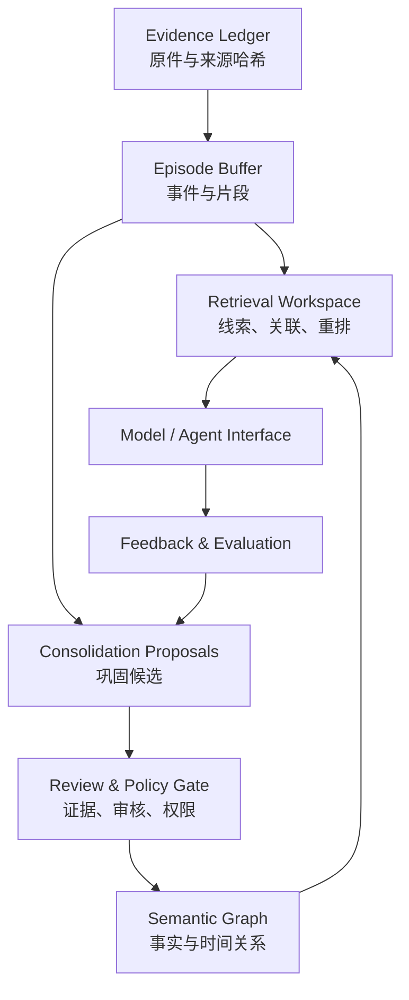

# NeuroMemory Cortex 架构与研究假设（ADR-001）

## 1. 修订后的科学目标

用户的目标是构建**功能性、可持续学习的个人记忆与认知系统**，并长期探索神经科学与人工智能的交叉机制。

“完全模拟人脑意识、人格与所有神经活动”是长期开放科学问题。当前不存在能够证明此目标在个人电脑上已经实现的验收方法。本项目不会把模拟神经元数、LLM 拟人表现、对话顺畅程度误作意识或人格复制的证据。

从已知的计算神经科学理论中借鉴的，是不同速度的学习、短期状态、持久记忆痕迹、记忆重放、线索提取和更新，而不是声称某一 SQLite 表代表实际脑区。

## 2. 自主设计方案：NeuroMnemonic Mesh（NMM）

**名称表示我们制定的工程组合方案，不声称已经发明未经研究的科学原理。** NMM 以来源事件为不可变地基，在其上构建多个可检查、可替换的记忆视图，未来引入双速率巩固与受控学习循环。

### 2.1 来源事件层 / Evidence Ledger（阶段 01 已实现）

原件保存 SHA-256，片段保存字符区间，保存独立且可审核的记忆候选。首次导入不会把文本自动解释成用户的真实经历。所有可写操作通过审计事件记录。

### 2.2 事件缓冲 / Episode Buffer（阶段 01 仅具原文片段）

未来增加 `event_time`、`recorded_time`、`narrator`、`participants`、`location`、`temporal_confidence`。个人经历、他人描述和外部公开资料不得互相冒充。

### 2.3 语义巩固 / Cortical Consolidation Graph（规划）

经证据检查的事实可以被整合为关联图。允许不同来源和不同时段的矛盾事实共存，采用版本化状态、有效时间和来源引用，不允许只用“最新摘要”覆盖历史。

### 2.4 认知工作区 / Retrieval Workspace（阶段 01 是精确查询）

未来逐步加入全文/向量/时间/图关系的混合检索，按任务需要动态分配上下文预算。必须返回检索证据、答复中使用了哪些来源，以及对无法回答问题的拒答能力。

### 2.5 自我模型 / Self-Model Engine（规划）

包括用户明确自述、用户确认的偏好、未经确认的行为规律假设和 AI 生成的待审核解释。任何推测必须可被用户删除或更正。项目不进行无根据的人格定型或心理诊断。

### 2.6 受控重放 / Offline Replay（研究阶段）

在不修改原始记忆的前提下，用离线模拟回放测试能否提高旧知识召回与新知识学习的兼容性。需在固定训练/计算预算下，与无重放基线比较。既有生物学工作支持离线重放与部分记忆过程相关，但不意味着我们的工程算法就是生物脑的机制。

### 2.7 神经动力学实验舱 / Neural Dynamics Lab（独立支线）

既有 LIF 程序与后续 SNN/STDP 在独立实验中探索。任何神经启发算法若要成为生产记忆模块，都需要证明其在准确率、延迟、算力、稳定性或数据效率方面相对简单基线确有收益。

## 3. 第一阶段核心模型

### 数据表

`sources` 存储原件身份、哈希、隐私分类和有效性；`passages` 存储精确文字、位置、原件关系；`claims` 存储尚未证实或已经审核的记忆陈述；`audit_events` 保存哈希链接的操作历史；`passage_fts` 是可丢弃并重建的查询索引。

### 关键不可变条件

1. `content_sha256` 与原始归档字节一致。
2. 任何片段必须满足 `decoded_source[start_char:end_char] == passage.content`。
3. 一个候选记忆必须关联有效的来源及其片段。
4. 用户明确确认前，记忆陈述只能是 `pending`。
5. 撤销来源后，它的片段、陈述不得继续参加有效检索。
6. 操作审计链可重新计算和核验；但不是抵抗全盘特权篡改的签名证明。
7. 非法编码、超大文件、未知扩展名、未授权请求不得写入。

## 4. 检索语义

当前搜索是**字面子串搜索**。3 个或更多 Unicode 字符优先由 SQLite FTS5 trigram 索引执行；1–2 字符走 SQLite `instr`。这对中文短语有实际价值，但不提供同义词、概念归纳或跨文件推理。

下一阶段引入可替换的 `EmbeddingProvider` 与 `Retriever`，评估以下方案：

- 全文字面检索（当前基础）；
- 混合检索（字面 + 本地向量）；
- 关联扩展（时间与人物关系）；
- 证据重排与可靠性判定。

正式采用之前要在同一标注数据集上对比，不能仅凭某工具宣传决定架构。

## 5. 模型运行与显卡规划

用户提供的硬件：Intel Core Ultra 9 290HX Plus、64 GB DDR5、NVIDIA RTX 5090 Laptop GPU 24 GB VRAM、约 1.9 TB SSD。

这些条件使本地量化模型、嵌入计算和科学模拟具有较好可行性，但**实际可装载规模取决于当前空闲显存、上下文长度、KV 缓存、模型量化格式与推理框架**。无法仅凭“24 GB 显存”推断任意 30B/70B 模型能够完整、快速驻留显卡。

第一阶段故意不加载 LLM：先证明记忆的存储、来源、检索与授权正确。第二阶段分别实测 Ollama 本地模型与授权云模型的正确性、延迟、显存占用、隐私处理与失败回退。

## 6. 演化时的依赖控制

`MemoryStore`、`SearchIndex`、`AgentRuntime`、`EmbeddingProvider`、`KnowledgeGraph` 应当通过接口分离；Mem0、Letta、Graphiti、Qdrant、LangGraph 是可以评估或替换的组件，**不是要同时安装运行的一揽子前提**。过早叠加框架会产生多个事实源和难以排查的更新路径。

## 7. 科学依据与技术资料

v0.2 新增的神经计算模型在 [`NEUROSCIENCE-MODELS.md`](NEUROSCIENCE-MODELS.md) 中给出方程、单位、测试边界与原始文献。v0.3 增加独立的几何形态可视化与 SWC 解析；v0.4 进一步实现 WebGL2 实例化表面网格、会话级 SWC 来源声明及 SHA-256、合成 LIF 膜电位与显示的单向映射。参见 [`MORPHOLOGY-V04.md`](MORPHOLOGY-V04.md)；跨层接口与未实施模块仍见 [`NEUROMNEMONIC-MESH-V02.md`](NEUROMNEMONIC-MESH-V02.md)。

- McClelland, James L., Bruce L. McNaughton, and Randall C. O'Reilly. “Why There Are Complementary Learning Systems in the Hippocampus and Neocortex.” *Psychological Review*, vol. 102, no. 3, 1995, pp. 419–457. https://pubmed.ncbi.nlm.nih.gov/7624455/.
- [The Role of Hippocampal Replay in Memory and Planning](https://pmc.ncbi.nlm.nih.gov/articles/PMC5847173/). 神经科学综述；其结论不能直接推导为工程方案已获生物验证。
- [SQLite FTS5 Official Documentation](https://www.sqlite.org/fts5.html). 包括 trigram tokenizer 的支持条件及短查询限制。
- [OpenAI: Developer MCP Documentation](https://developers.openai.com/api/docs/mcp). 后续模型工具连接的官方指导。
- [LongMemEval 官方项目](https://github.com/xiaowu0162/LongMemEval). 长期记忆评价的研究基准。
