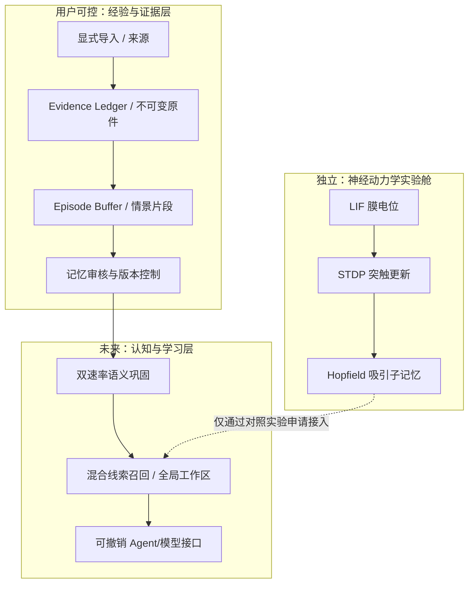

# NMM v0.2 · 神经—认知双层实验架构

## 总体原则

这是 NeuroMemory Lab 自行组合和定义的研究型系统架构。复杂度为科学问题服务，不以模块数量充当脑模拟可信度。将可运行模块、计划模块、尚无验证的假说分别标记。

## 当前已经真实运行

1. **Evidence Ledger**：显式授权导入、原始字节哈希、追踪位置、撤销、审计哈希链。
2. **Retrieval Workspace L0**：字面检索；可以确切指出字符串来自哪个原文片段。
3. **Memory Review Gate**：未经审核的陈述不会作为用户的已确认记忆。
4. **Neural Dynamics Lab L0**：LIF、简化 STDP 和 Hopfield 纯合成数据实验，确定性测试，不写个人数据库。
5. **Neural Field**：局部浏览器 Canvas 合成连线与脉冲展示，概念艺术图，不读取生物信号。

## 未来研究模块（当前没有实现）

| 模块 | 输入输出契约 | 基线与研究方向 |
|---|---|---|
| Episodic Time Graph | 事件时间、记录时间、叙述者、来源 | 对比普通时间戳知识库 |
| Semantic Consolidator | 已确认片段→待审语义候选 | 对比静态 RAG / 增量摘要 |
| Predictive Replay Scheduler | 候选与记忆重要性→离线回放计划 | 对比均匀抽样/随机回放 |
| Attractor Recall | 受损线索→候选关系/不确定性 | 对比关键词、嵌入向量、Hopfield |
| Self-Model Hypothesis Store | 经确认的行为反馈→版本化假设 | 校验错误归因、不确定性、过度概括 |
| Global Workspace Prototype | 多模块候选→受控可见状态 | 必须有可测的注意切换与任务收益 |
| Model Router | 本地模型优先；云模型需最小上下文授权 | 隐私预算、延迟与召回质量对照 |
| Open Knowledge Researcher | 公共资料→来源明确的研究候选 | 研究资料不得直接污染个人事实库 |

## 正式写入个人记忆前的 P0 门槛

- 用户可审阅精确导入清单，且不会自动扫描聊天记录、浏览器历史或文件夹。
- 应用层静态加密、密钥管理、备份策略、可验证删除机制。
- 向云模型发送上下文前可显示明文预览、逐项确认、拒绝与审计。
- 自我模型的推测、算法推断、证据不足必须与用户的自述分库存放。
- 公开仓库只发布源码和虚构测试数据； `.gitignore` 不应被当成唯一的泄漏防线。

## 性能路线

先在 CPU 上验证精确数值和小规模基线。未来在用户的 24GB RTX 5090 Laptop GPU / 64GB 内存上测试更大 SNN 和本地模型。所有性能结果必须记录环境、版本、随机种子、数据集、耗时、峰值显存和能耗估计，不得把未实测的算力用作宣传。
